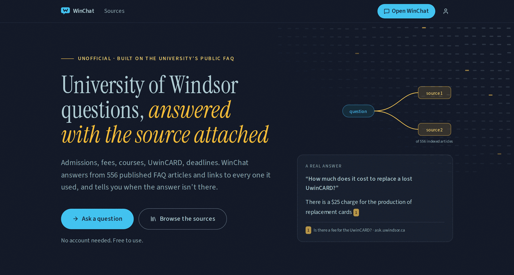

# WinChat

A retrieval-augmented assistant that answers University of Windsor questions from the
university's public FAQ, with a citation on every claim.

**[Try it](https://winchat.vercel.app)**, no account needed.

[](https://github.com/singhlify/winchat/actions/workflows/ci.yml)
[](LICENSE)



## What it does

- Answers from 556 published FAQ articles and links every source it used.
- Refuses rather than guesses, using a similarity threshold calibrated against this corpus.
- Hybrid retrieval: vector search and Postgres full-text search, fused by rank, then reranked.
- Streams the answer over SSE, with the sources arriving before the first token.
- Works signed out. Sign in with email, Google or GitHub to sync conversations across devices.

## Stack

Python and FastAPI for the retrieval and generation core, evaluated by a Python harness that
gates CI. Next.js and TypeScript on the front end. Postgres with pgvector on Supabase, which
also provides auth and row level security. Groq for generation, Cohere for embeddings and
reranking, both behind provider interfaces that take one environment variable to swap.
Deployed on Render and Vercel.

## Results

<!-- BEGIN GENERATED METRICS -->
Not yet generated. Run the commands below.
<!-- END GENERATED METRICS -->

Regenerate after any change that could move the numbers:

```bash
cd backend && uv run python -m winchat_api.evals.run --json eval-report.json
cd .. && uv run --project backend python scripts/update_metrics.py backend/eval-report.json
```

Two eval cases are known to fail and are listed in [KNOWN_ISSUES.md](KNOWN_ISSUES.md). The
deterministic gate names them, so a third failure breaks the build.

## Running it locally

You need [`uv`](https://docs.astral.sh/uv/), Node 20+ and pnpm. Embeddings are hosted, so
there is nothing to download. Set the keys and go.

```bash
# backend
cd backend
cp .env.example .env          # GROQ_API_KEY, COHERE_API_KEY, DATABASE_URL
uv sync
uv run python -m winchat_api.db.migrate          # schema, pgvector, RLS
uv run python -m winchat_api.ingestion.run       # chunk, embed, upsert
uv run uvicorn winchat_api.main:app --reload     # localhost:8000

# frontend, in a second terminal
cd frontend
cp .env.example .env.local
pnpm install && pnpm dev                         # localhost:3000
```

To run embeddings locally on open weights instead, `uv sync --extra local` and set
`EMBEDDING_PROVIDER=fastembed` (in process) or `ollama`. Either re-embeds the corpus on the
next ingest automatically.

```bash
uv run pytest                                     # backend tests
uv run python -m winchat_api.evals.run --tier1    # deterministic evals, no model cost
uv run python -m winchat_api.evals.run            # full suite, gated
uv run python -m winchat_api.ask "how do I drop a course?"
```

## License

MIT. See [LICENSE](LICENSE).
